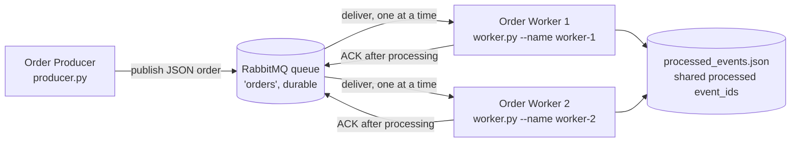

# Asynchronous Order Messaging with RabbitMQ

A small asynchronous messaging system in Python: an Order Producer publishes
order messages to a RabbitMQ queue, and independent Order Worker processes
consume and process them. The producer and workers run as separate processes
and communicate only through the queue.

## Architecture



```
Producer ──publish──> RabbitMQ queue 'orders' ──deliver──> Worker 1
                                                   └──> Worker 2
Workers ──ACK after processing──> queue
Workers ──record event_id──> processed_events.json (shared, file-locked)
```

Message format (every message carries exactly these fields):

```json
{"event_id": "45c603d0-ff89-4dbf-9b5a-233aee32c6ac", "order_id": "ORD-1001", "item_id": "widget", "quantity": 1}
```

Key design choices:

- **Durable queue, persistent messages** (`delivery_mode=2`): queued orders
  survive a broker restart.
- **Manual ACK, `prefetch_count=1`**: a worker ACKs only after processing
  finishes, and RabbitMQ hands each worker at most one unacknowledged
  message at a time. That is what makes the workers fair competing
  consumers instead of one worker grabbing the whole queue.
- **Independent processes**: the producer exits after publishing; each
  worker is its own process and can be started, stopped, or crashed
  without stopping the others.
- **Atomic duplicate claim**: check and claim are one step under an
  exclusive file lock. A worker records `event_id -> {status: processing,
  worker, pid}` before processing; a second copy sees a live claim or a
  `processed` record and drops out as a duplicate, so two simultaneous
  copies cannot both run the business action. A claim whose PID is dead
  (including a zombie, checked via `/proc/<pid>/status`) is reclaimable,
  so crash redelivery is not mistaken for a duplicate.
- **Broker redelivery flag**: every receipt logs `method.redelivered`,
  so a redelivery is shown directly by the broker (`redelivered=True`),
  not inferred from the log sequence.

## Running

Requirements: Python 3.10+, Docker (for RabbitMQ), or a local RabbitMQ
on `localhost:5672`.

```bash
# 1. Start RabbitMQ (management UI at http://localhost:15672, guest/guest)
docker compose up -d

# 2. Install the only dependency
pip install -r requirements.txt

# 3. Start two workers, in two separate terminals
python worker.py --name worker-1
python worker.py --name worker-2

# 4. Publish orders, in a third terminal
python producer.py --count 5
```

Stop everything with Ctrl-C in the worker terminals, then
`docker compose down`. To start from a clean slate between demos, delete
`processed_events.json` and purge the queue (or restart the broker).

Evidence below was run against RabbitMQ 3.12.1 on localhost, Python 3.12,
pika 1.4.4. Full, unedited terminal output for each demo is in `evidence/`.

## Example: successful message processing

`python producer.py --count 5` with both workers running. Full log:
`evidence/successful-processing.log`.

```
[producer] published event_id=dbac9263-... order_id=ORD-1001 item_id=widget quantity=1
[producer] published event_id=8d57df12-... order_id=ORD-1002 item_id=widget quantity=1
[worker-1 12:14:38] received event_id=dbac9263-... order_id=ORD-1001 item_id=widget quantity=1 redelivered=False
[worker-1 12:14:38] processing order ORD-1001 ...
[worker-2 12:14:38] received event_id=8d57df12-... order_id=ORD-1002 item_id=widget quantity=1 redelivered=False
[worker-1 12:14:39] processed order ORD-1001 (event_id=dbac9263-...), sending ACK
[worker-2 12:14:39] processed order ORD-1002 (event_id=8d57df12-...), sending ACK
```

All 5 messages were processed and ACKed, 5 unique `event_id`s recorded.

## Evidence: two competing consumers

`python producer.py --count 6` with worker-1 and worker-2 on the same
queue. Full log: `evidence/competing-consumers.log`.

Each order was processed by exactly one worker, and the work was split
across both:

| Order | Processed by |
|-------|--------------|
| ORD-1001 | worker-2 |
| ORD-1002 | worker-1 |
| ORD-1003 | worker-1 |
| ORD-1004 | worker-2 |
| ORD-1005 | worker-1 |
| ORD-1006 | worker-2 |

No order appears under both workers. That is the competing-consumer
pattern: RabbitMQ delivers each message to one consumer only, and
`prefetch_count=1` keeps the split roughly even instead of letting the
first worker drain the queue.

## Evidence: failure and redelivery

Start worker-1 in crash mode and worker-2 normally, then publish one
message with a fixed `event_id`:

```bash
python worker.py --name worker-1 --fail-on evt-crash-001
python worker.py --name worker-2
python producer.py --event-id evt-crash-001 --order-id ORD-9001 --item-id widget --quantity 2
```

Full log: `evidence/failure-redelivery.log`.

```
[worker-1 12:14:50] received event_id=evt-crash-001 order_id=ORD-9001 item_id=widget quantity=2 redelivered=False
[worker-1 12:14:50] SIMULATED CRASH on event_id=evt-crash-001 -- exiting WITHOUT ACK (message will be redelivered)
[worker-2 12:14:50] received event_id=evt-crash-001 order_id=ORD-9001 item_id=widget quantity=2 redelivered=True
[worker-2 12:14:50] REDELIVERY: broker redelivered flag is True for event_id=evt-crash-001 -- this is a broker redelivery, not a new publish
[worker-2 12:14:50] RECLAIMED event_id=evt-crash-001 -- previous claim by worker-1 (pid 12977) is dead, so this redelivery will be processed
[worker-2 12:14:50] processing order ORD-9001 ...
[worker-2 12:14:51] processed order ORD-9001 (event_id=evt-crash-001), sending ACK
```

What happened, in order: (1) worker-1 received the message
(`redelivered=False`), (2) it exited before ACKing and before marking
the event processed, (3) RabbitMQ requeued the message and delivered it
again to worker-2, and the broker itself marks that second delivery
`redelivered=True` -- that flag, printed on the receipt line and in the
`REDELIVERY` line, is direct proof of redelivery, not just the log
sequence. Worker-2 reclaims worker-1's dead claim, processes, and ACKs.
Worker-2 kept running throughout, so the system as a whole never went
down, and the order was not lost.

## Evidence: duplicate handling

Workers share `processed_events.json`, where each `event_id` maps to
`{status: processing | processed, worker, pid}`. Check and claim are a
single step under an exclusive file lock: a worker claims the event
before processing, so a second copy -- simultaneous or later -- sees a
live claim or a `processed` record and drops out as a duplicate. Only a
claim whose PID is dead can be reclaimed, which is what lets crash
redelivery through. Publish the same `event_id` twice at once, then
again after it is processed:

```bash
python worker.py --name worker-1
python worker.py --name worker-2
python producer.py --event-id evt-dup-001 --order-id ORD-9002 --item-id widget --quantity 1 --repeat 2
python producer.py --event-id evt-dup-001 --order-id ORD-9002 --item-id widget --quantity 1
```

Full log: `evidence/duplicate-handling.log`.

```
[worker-2 12:14:55] received event_id=evt-dup-001 order_id=ORD-9002 item_id=widget quantity=1 redelivered=False
[worker-1 12:14:55] received event_id=evt-dup-001 order_id=ORD-9002 item_id=widget quantity=1 redelivered=False
[worker-1 12:14:55] DUPLICATE detected for event_id=evt-dup-001 -- already being processed by worker-2 (pid 13025 still alive) -- skipping business action, ACKing to drop it
[worker-2 12:14:55] processing order ORD-9002 ...
[worker-2 12:14:56] processed order ORD-9002 (event_id=evt-dup-001), sending ACK
[worker-1 12:14:56] received event_id=evt-dup-001 order_id=ORD-9002 item_id=widget quantity=1 redelivered=False
[worker-1 12:14:56] DUPLICATE detected for event_id=evt-dup-001 -- already processed by worker-2 -- skipping business action, ACKing to drop it
```

Both the simultaneous copy and the later sequential copy were caught,
by a different worker than the one that processed the order, which is
why the store is shared rather than per-worker. The business action ran
exactly once: the store ends with exactly one processed entry,
`evt-dup-001`. Each duplicate is ACKed, so RabbitMQ does not redeliver
it forever.

## Files

| File | Purpose |
|------|---------|
| `producer.py` | Publishes order messages (`--count`, or a single `--event-id` / `--order-id`, with `--repeat` to republish). |
| `worker.py` | Consumes, logs, processes, ACKs. `--name`, `--fail-on <event_id>` for the crash demo, `--delay` for simulated processing time, `--store` for the processed-event file. |
| `docker-compose.yml` | RabbitMQ with management UI. |
| `requirements.txt` | `pika` only. |
| `evidence/` | Full terminal logs for all four demos above. |

## Reflection

RabbitMQ gives at-least-once delivery, not exactly-once: if a worker
crashes, loses its connection, or its ACK is lost after processing, the
broker cannot tell whether the work happened, so it redelivers the
message to keep it from being lost. A message can therefore arrive more
than once even when nothing is "wrong" with the producer. Idempotent
handling fixes the consequence rather than the delivery: by keying the
business action on a stable `event_id` and skipping any event already
recorded as processed, a redelivered message becomes a harmless no-op
instead of a double-charged, double-shipped order. That combination --
at-least-once delivery plus idempotent consumers -- is what makes the
system both reliable (nothing lost on crash) and correct (nothing done
twice).
